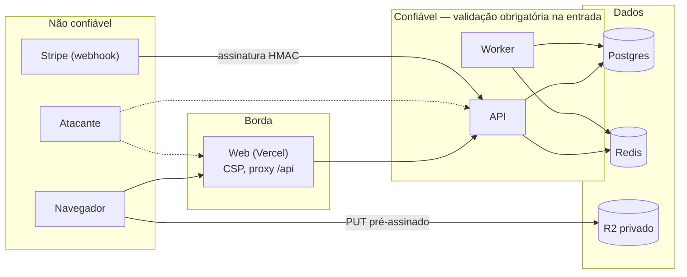

# Modelo de segurança

Referências: **OWASP ASVS 5.0, nível 2**, **OWASP API Security Top 10 (2023)** e **LGPD** (ver [PRIVACY.md](PRIVACY.md)). Para relatar uma vulnerabilidade, veja o [SECURITY.md](../SECURITY.md).

Este documento é vivo: cada PR que cria uma superfície nova (rota, integração, fila) atualiza a seção correspondente, e cada controle aponta para o teste que o prova.

## 1. Ativos e atores

| Ativo | Por que importa |
| --- | --- |
| Estoque de ingressos | Overbooking é falha de negócio grave e irreversível na porta do evento. |
| Status do pedido | Marcar um pedido como pago sem pagamento = ingresso grátis. |
| Token do QR | Quem tem um token válido entra no evento. |
| Sessões e credenciais | Tomada de conta dá acesso a ingressos e dados pessoais. |
| Dados pessoais (nome, e-mail, titular) | Obrigação legal (LGPD) e confiança. |
| Segredos (chaves do Stripe, HMAC, JWT, banco) | Comprometem todo o resto. |
| Log de auditoria | Prova do que aconteceu; precisa ser íntegro. |

| Ator | Confiança |
| --- | --- |
| Visitante anônimo | Nenhuma |
| Comprador autenticado | Só sobre os próprios pedidos e ingressos |
| Organizador | Só sobre os próprios eventos; vê agregados, não dados pessoais de compradores |
| Operador de check-in | Organizador dono do evento (MVP) |
| Admin | Alta, mas toda ação é auditada |
| Stripe | Confiável **somente** quando a assinatura do webhook confere |
| Atacante externo | Pode automatizar requisições, reenviar tráfego, forjar QR, tentar acessar recursos de terceiros |

## 2. Fronteiras de confiança

Toda entrada que cruza para a zona "App" é validada (Zod, estrito), autenticada e autorizada. O Redis é tratado como cache/fila: nada crítico depende só dele.

## 3. STRIDE por fluxo

Legenda: **S**poofing, **T**ampering, **R**epudiation, **I**nformation disclosure, **D**enial of service, **E**levation of privilege.

### 3.1 Login e sessão

| | Ameaça | Controle | Prova |
| --- | --- | --- | --- |
| S | Credential stuffing / força bruta | Rate limit por IP e por conta; bloqueio progressivo (`locked_until`) após 5 falhas; argon2id (m=19 MiB, t=2, p=1, parâmetros OWASP) torna o ataque offline caro; mensagem genérica de erro. | `auth.int.test.ts` (rate limit por IP e por conta, bloqueio e desbloqueio, tudo contra Redis e Postgres reais); `login-user.test.ts` |
| S | Roubo de sessão por XSS | Cookies `HttpOnly`, `Secure`, prefixo `__Host-`; CSP estrita com nonce; React escapa por padrão; markdown sanitizado. | `sessions.int.test.ts`: flags exatas dos três cookies (sem `Domain`); teste de CSP no E2E |
| S | Reuso de refresh token roubado | Refresh opaco, guardado só como hash SHA-256, **rotação a cada uso** e **detecção de reuso**: token já rotacionado revoga a família inteira. Expiração ociosa de 7 dias e absoluta de 30. | `sessions.int.test.ts`: o token antigo reapresentado revoga a família (inclusive o token novo do dono) e gera auditoria; dois refreshes simultâneos com o mesmo token → só um rotaciona; expiração ociosa e absoluta; `sessions.test.ts` |
| S | Login CSRF / CSRF em ações | `SameSite=Lax`; em todo método inseguro, `Origin` igual ao do web (ou, sem `Origin`, `Sec-Fetch-Site: same-origin`); nas rotas que exigem papel e chegam com o cookie de acesso, token double-submit assinado (HMAC com o id da sessão) no header `X-CSRF-Token` igual ao cookie. OAuth com `state` e PKCE. | `request-security.e2e.test.ts` e `sessions.int.test.ts`: POST sem token, com token só no header, com token de outra sessão → 403; login com origem estranha → 403 e nenhuma sessão |
| S | Tomada de conta via OAuth com e-mail não verificado | Vínculo automático com conta existente (e criação de conta) só quando o provedor afirma e-mail verificado (`email_verified` no Google; e-mail **primário** verificado no GitHub). Vínculo por id da conta no provedor, nunca por e-mail depois do primeiro login. | `oauth-login.test.ts` e `oauth.int.test.ts`: perfil não verificado não cria nem vincula conta, nem entra numa existente |
| S | Pré-cadastro de conta alheia (alguém cadastra o e-mail da vítima com senha própria e espera ela entrar pelo Google) | Ao vincular um provedor a uma conta nunca verificada, o e-mail passa a verificado e a senha é apagada; o registro de auditoria marca `tookOverUnverified`. | `oauth.int.test.ts`: a senha do pré-cadastro deixa de funcionar (`401`) |
| S | Login CSRF e injeção de código no OAuth | `state` de 256 bits num cookie `HttpOnly` cifrado com AES-256-GCM (10 min, uso único; verificador e `nonce` ilegíveis fora do servidor) e comparado em tempo constante; PKCE S256; `nonce` no ID token do Google. | `oauth.e2e.test.ts`: callback sem o cookie, com `state` de outra tentativa, de outro provedor, adulterado ou expirado → `oauth-failed` sem trocar o código |
| S | ID token forjado ou de outro cliente | Só `RS256` (header comparado por esquema; `none`/HS256 recusados antes da verificação), chave do JWKS do Google por `kid` (cache de 1 h, nova busca no máximo a cada minuto), `iss`, `aud`/`azp`, `exp`, `iat` e `nonce` conferidos. | `google-oauth-provider.test.ts` |
| S | Redirecionamento aberto depois do login | `next` só aceita caminho do próprio web (`/` seguido de caractere que não seja `/` ou `\`, ASCII visível, até 512). | `oauth.test.ts` (domínio) e `oauth.e2e.test.ts` |
| T | Adulteração do JWT | Assinatura HS256 com segredo ≥ 256 bits, `alg` fixado na verificação, `iss`/`aud`/`exp` validados, expiração de 10 min. | `access-token.test.ts` e `request-security.e2e.test.ts`: `alg: none`, outro algoritmo, assinatura trocada, papel adulterado, assinado com a chave do CSRF, emissor e audiência errados |
| R | Usuário nega ter feito login ou alterado senha | Auditoria de `auth.login_succeeded/failed`, `password_changed` (`via`: `reset` ou `change`), `password_reset_requested`, `email_change_requested`, `email_changed`, `refresh_reuse_detected`, `logout_all`, `session_revoked`; aviso por e-mail ao dono quando a senha muda ou alguém pede a troca do e-mail. | `auth.int.test.ts`: cadastro, verificação, login com sucesso e falha, bloqueio, e a ausência de e-mail, nome e senha no log; `sessions.int.test.ts`: reuso e `logout-all` auditados |
| I | Enumeração de contas | Cadastro, "esqueci a senha" e troca de e-mail respondem `202` idêntico (na troca para um e-mail de outra conta, quem é avisado é o dono do endereço); login responde `invalid-credentials` genérico; tempo de resposta equalizado (hash fictício quando o usuário não existe). | `auth.int.test.ts`: cadastro de e-mail novo e conhecido com respostas idênticas; senha errada e e-mail inexistente indistinguíveis e com o mesmo custo (uma verificação argon2id cada); `argon2-password-hasher.test.ts`; `account.int.test.ts`: "esqueci a senha" e troca para e-mail de outra conta com a mesma resposta |
| S | Senha vazada em outro serviço (credential stuffing) | Cadastro, redefinição e troca recusam senhas que aparecem no Pwned Passwords (k-anonymity: só 5 dígitos do SHA-1 saem do servidor). | `pwned-passwords.test.ts` (o que é enviado, padding, falha aberta), `credentials.test.ts`, `account.int.test.ts` |
| S | Link de redefinição interceptado ou reaproveitado | Token de 256 bits no fragmento da URL, só o SHA-256 no banco, 30 min, uso único com `UPDATE` condicional, só o mais recente vale; a redefinição revoga todas as sessões e avisa o dono por e-mail. | `credentials.test.ts`; `account.int.test.ts`: dois resets simultâneos com o mesmo token → um `204` e um `410`, sessões antigas sem refresh |
| S | Sessão roubada usada para tomar a conta (trocar senha ou e-mail) | Troca de senha e de e-mail pedem a senha atual (5 tentativas a cada 15 min por conta); o e-mail só muda pelo link enviado ao novo endereço, e o endereço atual é avisado; a troca de senha encerra as outras sessões. | `credentials.test.ts`, `account.int.test.ts` |
| D | Esgotar CPU com argon2 | Rate limit antes do hash; limite de tamanho da senha (8–128 caracteres). | `auth.e2e.test.ts`: senha gigante → 400 sem nenhum hash; `auth.int.test.ts`: 429 sem nenhum hash |
| E | Usuário se promove a ADMIN | Papel nunca vem do corpo (schemas estritos); mudança de papel só por `ADMIN` e auditada; papel lido do banco ao emitir o JWT (inclusive a cada refresh). | `auth.e2e.test.ts` e `auth.int.test.ts`: `role` no corpo do cadastro → 400 e nenhuma conta criada; `account.e2e.test.ts` e `account.int.test.ts`: `role`, `email`, `emailVerified` ou `slug` no corpo de `PATCH /me` e `POST /me/organizer` → 400 e nada muda. Virar ORGANIZER é autosserviço (`POST /me/organizer`); ADMIN nunca. |

### 3.2 Compra (reserva e pagamento)

| | Ameaça | Controle | Prova |
| --- | --- | --- | --- |
| S | Comprar em nome de outra conta | Pedido sempre vinculado ao usuário da sessão; `buyerId` nunca aceito do cliente. | Teste de mass assignment |
| T | Alterar preço ou total no front | O cliente envia só `ticketTypeId` e `quantity`; preço e total são lidos do banco; o PaymentIntent é criado no servidor com o valor do pedido. | Teste: corpo com `priceCents` → 400; valor do PaymentIntent = total do banco |
| T | Overbooking por condição de corrida | `UPDATE` condicional atômico + `CHECK (sold + reserved <= capacity)` no banco ([ADR-0007](adr/0007-controle-de-estoque.md)). | Teste de concorrência: N compras simultâneas da última vaga → exatamente 1 sucesso |
| T | Pedido duplicado por reenvio | `Idempotency-Key` com `UNIQUE(buyer_id, idempotency_key)` e hash do corpo. | Teste de replay com mesmo e com outro corpo |
| R | Comprador contesta a compra | Auditoria de `order.created/paid/expired/canceled/refunded` com `requestId`; registro do PaymentIntent. | — |
| I | Ver pedido de outra pessoa (BOLA) | Consulta sempre filtrada por `buyerId` na camada `application`; resposta `404` para recurso alheio. | Teste de autorização para cada rota de pedido |
| I | Dados de cartão expostos | Payment Element em iframe; nenhum dado de cartão toca nossos servidores (escopo PCI SAQ A); CSP permite só `js.stripe.com`. | Revisão de CSP |
| D | Esgotar estoque com reservas falsas (scalping, abuso de fluxo de negócio — API6) | Login com e-mail verificado para comprar; 1 pedido `PENDING` por comprador por evento; `max_per_order`; reserva expira em 10 min com extensão única; rate limit de criação de pedido. | Testes de cada limite |
| E | Pular o pagamento e chamar a emissão | Não existe rota de emissão; tickets são criados só na transação do webhook verificado; trigger no banco exige pedido `PAID`. | Teste: inserir ticket para pedido `PENDING` falha no banco |

### 3.3 Webhook de pagamento

| | Ameaça | Controle | Prova |
| --- | --- | --- | --- |
| S | Webhook forjado marcando pedido como pago | Verificação da assinatura `Stripe-Signature` com o segredo do endpoint sobre o **body bruto**; tolerância de 5 min no timestamp; nada é processado antes da verificação. | Teste: assinatura inválida → 400, nenhum efeito |
| S | Evento de outra conta Stripe ou de modo live | Confere `livemode === false` e que `metadata.orderId` existe e o `amount`/`currency` batem com o pedido. | Teste com valor divergente → registrado e ignorado |
| T | Replay de evento legítimo | `processed_webhook_events` com PK = `event.id`, gravado na mesma transação do efeito; tolerância de timestamp. | Teste: mesmo evento duas vezes → um efeito |
| T | Eventos fora de ordem | Transições condicionais (`WHERE status = ...`); efeitos idempotentes. | Teste de sequência invertida |
| R | Divergência entre Stripe e banco | Auditoria `payment.webhook_processed` com `event.id`; reconciliação manual documentada no runbook. | — |
| I | Payload com dados de cobrança em log | Payload não é logado nem persistido; só `event.id` e `type`. | Teste de redação dos logs |
| D | Inundação do endpoint | Limite de body (1 MB), verificação de assinatura barata antes de qualquer I/O de banco, rate limit por IP generoso. | — |
| E | Webhook usado para disparar ações administrativas | Endpoint trata uma allowlist de tipos de evento; qualquer outro é confirmado com `200` e ignorado. | Teste com tipo desconhecido |

### 3.4 Check-in

| | Ameaça | Controle | Prova |
| --- | --- | --- | --- |
| S | QR forjado ou adivinhado | Token assinado com HMAC-SHA256 (chave ≥ 256 bits, rotacionável por `kid`), contendo id do ingresso + nonce aleatório de 128 bits; comparação em tempo constante ([ADR-0008](adr/0008-qr-code-assinado.md)). O código legível `VIRA-XXXX-XXXX` (40 bits aleatórios) só funciona com rate limit e por organizador autenticado do evento. | Teste: token alterado em 1 byte → `INVALID` |
| S | Pessoa não autorizada validando ingressos | Rota exige ORGANIZER dono do evento; resposta `404` para evento alheio. | Teste de autorização |
| T | Usar o mesmo ingresso duas vezes (print do QR) | `UPDATE ... WHERE status = 'VALID'` atômico: só a primeira leitura vence; as seguintes recebem `ALREADY_USED` com horário. | Teste de concorrência: 2 leituras simultâneas → 1 `VALID`, 1 `ALREADY_USED` |
| T | QR antigo após reemissão | Nonce trocado invalida tokens anteriores. | Teste |
| R | Operador nega ter validado | `checkin_attempts` registra toda leitura com operador; auditoria `ticket.checked_in`. | — |
| I | Vazamento de dados pelo scanner | Resposta mostra só nome do titular, tipo e código; nada de e-mail do comprador. | Teste de contrato da resposta |
| D | Força bruta de códigos manuais | 20/min por operador no `/checkin/code`; tentativas registradas. | Teste de rate limit |
| E | Ingresso de um evento aceito em outro | `event_id` do ingresso precisa ser o evento informado; caso contrário `WRONG_EVENT`. | Teste |

#### Limites conhecidos do login por senha (N3)

Decisões tomadas e riscos aceitos, para o revisor não precisar redescobri-los:

- **Senhas vazadas (HIBP):** verificadas a partir da N6 (veja "Limites conhecidos da conta" abaixo).
- **Bloqueio por terceiros:** quem sabe o e-mail de alguém pode bloquear a conta por até 1 h, falhando de propósito. Aceito: o limite por IP (10 a cada 15 min) e o crescimento gradual (1 min na primeira vez) limitam o dano, e a alternativa (não bloquear) deixa a conta aberta a adivinhação. A contagem de falhas não decai com o tempo; só zera no login com sucesso.
- **Aviso "você já tem conta" como canal de spam:** cada cadastro de um e-mail conhecido gera um e-mail ao dono do endereço. Limitado a 5/h por IP; não há limite por destinatário.
- **Redis fora do ar:** o limitador deixa passar (e registra). O bloqueio por conta, no banco, segue valendo.
- **Tempo de resposta:** o cadastro (hash antes da consulta) e o login (uma verificação em todos os caminhos) igualam o custo dominante. Sobra a diferença de uma ou duas escritas no banco, de ordem muito menor.
- **Auditoria depois do commit:** o registro é gravado logo após a operação, não na mesma transação; uma falha entre os dois responde `500` embora a operação tenha ocorrido.
- **Reenvio da verificação:** `POST /auth/email/resend` exige sessão (API.md), mas sem e-mail verificado não há sessão. Quem perdeu o e-mail de verificação ainda não tem como pedir outro; a decisão está listada no PROGRESS.md.

#### Limites conhecidos das sessões (N4)

- **Revogação em até 10 min:** logout, `logout-all` e a revogação de uma sessão param o refresh na hora, mas um token de acesso já emitido vale até expirar (não há consulta ao banco a cada requisição, ADR-0005).
- **Refreshes simultâneos derrubam a sessão:** se duas abas renovarem ao mesmo tempo com o mesmo cookie, a segunda apresenta um token já rotacionado e a família é revogada (a regra é estrita de propósito: não dá para distinguir esse caso de um roubo). O web (N7) precisa serializar o refresh, um por vez.
- **Rotas públicas não pedem token CSRF:** elas não agem com a sessão. Login, cadastro, verificação e refresh ficam protegidos pela checagem de `Origin`/`Sec-Fetch-Site` e pelo `SameSite=Lax`. O refresh só troca o cookie do próprio navegador.
- **Clientes sem `Origin` nem `Sec-Fetch-Site`** (curl, apps) passam pela checagem de origem: um navegador sempre manda um dos dois em requisições que alteram dados.
- **Sessões sem dispositivo:** a lista de sessões mostra só datas (login, última renovação, expiração). Guardar `User-Agent` ou IP seria dado pessoal a mais (LGPD, só nome e e-mail).

#### Limites conhecidos da redefinição de senha e da conta (N6)

- **Checagem de senhas vazadas falha aberta:** se o Pwned Passwords não responder em 3 s (ou responder com erro), a senha é aceita sem checagem e o log registra o aviso. Recusar cadastros e redefinições durante uma queda de terceiro seria pior. A consulta leva os 5 primeiros dígitos do SHA-1 da senha: é o que o protocolo exige e não basta para descobrir a senha (cada faixa tem centenas de sufixos, e a resposta vem com padding).
- **"Esqueci a senha" não iguala o tempo de resposta:** para um e-mail com conta há uma gravação na outbox e uma na auditoria; sem conta, nenhuma. A diferença é de poucos milissegundos, sem hash nenhum dos dois lados (o mesmo nível aceito no cadastro).
- **Link de redefinição continua valendo depois de uma troca de e-mail:** um link pedido antes da troca, enviado ao endereço antigo, ainda funciona até expirar (30 min).
- **Token de acesso com papel antigo:** depois de `POST /me/organizer`, o token de acesso atual ainda diz BUYER até o próximo refresh (no máximo 10 min). O web chama `POST /auth/refresh` logo depois.
- **Avisos por e-mail como canal de spam:** a troca de e-mail para um endereço de outra conta avisa o dono do endereço; limitado a 3 pedidos por hora por conta autenticada (e o pedido exige a senha).

## 4. Controles transversais

| Área | Controle |
| --- | --- |
| Autorização | Guard global "negar por padrão": toda rota declara `@Public()` ou um papel; teste automatizado falha se alguma rota não declarar. Posse verificada em `application` com políticas por recurso. |
| Validação | Zod estrito (`.strict()`) em corpo, query e params; limites de tamanho em todos os textos e arrays. |
| Markdown | `markdown-it` com HTML desligado → `sanitize-html` com allowlist (`p`, `strong`, `em`, `ul`, `ol`, `li`, `a[href]`, `h3`, `h4`, `blockquote`, `br`); links com `rel="noopener noreferrer nofollow ugc"`; só `https:` e `mailto:`. Renderizado no servidor e salvo; o web não usa `dangerouslySetInnerHTML` com conteúdo não sanitizado. |
| Cabeçalhos | Helmet na API; no web: CSP com nonce gerado a cada requisição em `src/proxy.ts` (implementado no F7 com `default-src 'self'`, `script-src 'self' 'nonce-…' 'strict-dynamic'`, `object-src 'none'`, `base-uri 'none'`, `frame-ancestors 'none'`; os domínios do Stripe entram no checkout, V6). O `style-src` leva só `self` e o nonce (sem `unsafe-inline` em produção): por isso os componentes de interface não escrevem `style` inline no HTML do servidor e o `<style>` do travamento de rolagem dos modais recebe o nonce (N2). Desenho completo: (`default-src 'self'; script-src 'self' 'nonce-…' https://js.stripe.com; frame-src https://js.stripe.com https://hooks.stripe.com; img-src 'self' data: <cdn do R2>; connect-src 'self' https://api.stripe.com; object-src 'none'; base-uri 'none'; frame-ancestors 'none'`), HSTS, `Referrer-Policy: strict-origin-when-cross-origin`, `Permissions-Policy` (câmera só na rota de check-in). |
| CORS | Somente a origem do web; credenciais permitidas; webhook sem CORS. |
| Limites | Body JSON 100 kB; paginação máx. 50; timeouts de requisição 10 s; consultas com `statement_timeout` de 5 s. |
| Upload | URL pré-assinada de `PUT` com `Content-Type` e `Content-Length` fixados na assinatura, expiração de 5 min, chave gerada pelo servidor; bucket privado; confirmação valida magic bytes e dimensões; imagens re-encodadas (remove EXIF/GPS) antes de servir. |
| SSRF (API7) | O servidor nunca busca URLs informadas por usuário; imagens só chegam por upload direto. |
| Segredos | Somente variáveis de ambiente, validadas no boot; nunca no repositório (gitleaks no pre-commit e no CI); chaves separadas por ambiente; rotação documentada. |
| Dependências | Dependabot semanal, `pnpm audit` no CI, CodeQL, lockfile congelado no CI, actions de terceiros fixadas no SHA do commit (o Dependabot mantém os pins atualizados) e as do GitHub por versão. |
| Auditoria | `AuditLog.record()` (módulo `audit`) grava ações sensíveis em `audit_logs`, append-only por trigger; cada ação tem schema de `metadata` estrito, sem dados pessoais. |
| Logs | Sem dados pessoais nem segredos (redação no pino); `requestId` em tudo; Sentry com `sendDefaultPii: false` e `beforeSend` sanitizando. |
| Banco | Usuário da aplicação sem privilégio de DDL em produção (migrations com outro papel); `audit_logs` só `INSERT`/`SELECT`; TLS obrigatório (a API recusa subir em produção sem `sslmode=require` no `DATABASE_URL` e sem `rediss://` no `REDIS_URL`); `statement_timeout` de 5 s e timeout de conexão de 5 s. |
| Inventário (API9) | OpenAPI gerado do código, versão única `/api/v1`, `/docs` protegido em produção; rotas não documentadas falham no teste de contrato. |
| Consumo de APIs (API10) | Respostas do Stripe e dos provedores OAuth validadas com Zod; timeouts e retentativas com limite. |
| Demo | Configuração recusa chaves live do Stripe; aviso permanente de modo de teste na interface. |

## 5. OWASP API Security Top 10 (2023)

| Risco | Como o Vira trata |
| --- | --- |
| API1 Broken Object Level Authorization | Posse verificada em `application`; `404` para recurso alheio; teste por rota. |
| API2 Broken Authentication | argon2id, rate limit, bloqueio, refresh rotativo com detecção de reuso, JWT curto. |
| API3 Broken Object Property Level Authorization | Schemas estritos de entrada; DTOs de saída explícitos (sem serializar entidades). |
| API4 Unrestricted Resource Consumption | Rate limit, limites de body/paginação/upload, timeouts. |
| API5 Broken Function Level Authorization | Guard "negar por padrão" + papel por rota + teste que varre todas as rotas. |
| API6 Unrestricted Access to Sensitive Business Flows | Limites de reserva (1 pendente por evento, `max_per_order`, expiração), e-mail verificado para comprar. |
| API7 Server Side Request Forgery | Nenhum fetch de URL informada por usuário. |
| API8 Security Misconfiguration | Helmet/CSP, config validada, `/docs` protegido, erros sem stack. |
| API9 Improper Inventory Management | OpenAPI gerado, versão única, ambientes documentados. |
| API10 Unsafe Consumption of APIs | Validação de respostas externas, assinatura de webhook, timeouts. |

## 6. Checklist ASVS 5.0 — nível 2

Status: ⬜ planejado · 🟨 em andamento · ✅ implementado e testado. O marco indica onde o controle entra ([ROADMAP.md](ROADMAP.md)).

| Capítulo | Controles principais para o Vira | Marco | Status |
| --- | --- | --- | --- |
| V1 Encoding and Sanitization | Escapamento por contexto (React), markdown sanitizado com allowlist, Prisma parametrizado (sem SQL cru concatenado), saída JSON sempre serializada. | Núcleo | ⬜ |
| V2 Validation and Business Logic | Zod estrito em toda entrada; regras de negócio no `domain`; limites anti-abuso no fluxo de compra; operações sensíveis em ordem garantida (transições condicionais). | Núcleo / MVP | ⬜ |
| V3 Web Frontend Security | CSP com nonce, cookies `__Host-`, `SameSite`, HSTS, proteção contra clickjacking, `Sec-Fetch-*`. | Fundação / MVP | 🟨 |
| V4 API and Web Service | Métodos HTTP corretos, `Content-Type` verificado, limites de tamanho, OpenAPI coerente com o código. | Fundação | 🟨 |
| V5 File Handling | Upload pré-assinado com tipo e tamanho fixados, verificação de magic bytes, re-encode, bucket privado, nomes gerados pelo servidor. | Núcleo | ⬜ |
| V6 Authentication | argon2id, política de senha (8–128, checagem contra senhas vazadas via k-anonymity HIBP), anti-enumeração, rate limit e bloqueio, redefinição com token de uso único. N3 entregou argon2id, política 8–128, anti-enumeração, rate limit, bloqueio e verificação de e-mail; N6, a checagem HIBP e a redefinição (mais a reautenticação para trocar senha e e-mail). | Núcleo | ✅ |
| V7 Session Management | Refresh opaco com hash, rotação, detecção de reuso, expiração ociosa e absoluta, logout e logout global, revogação ao trocar senha. N4 entregou tudo menos a revogação ao trocar senha, que veio na N6 (a redefinição revoga todas; a troca, todas menos a atual). | Núcleo | ✅ |
| V8 Authorization | Negar por padrão, papel por função, posse por recurso, testes de autorização em toda rota. | Núcleo / MVP | ⬜ |
| V9 Self-contained Tokens | JWT com `alg` fixo, `iss`/`aud`/`exp` validados, vida curta; token do QR com HMAC e `kid`. N4 entregou o JWT; falta o token do QR (V5). | Núcleo / MVP | 🟨 |
| V10 OAuth and OIDC | Authorization Code + PKCE, `state`, validação do `id_token` (Google), vínculo só com e-mail verificado, sem guardar tokens do provedor. N5 entregou tudo. | Núcleo | ✅ |
| V11 Cryptography | Bibliotecas padrão (`node:crypto`, argon2), aleatoriedade com CSPRNG, comparação em tempo constante, chaves ≥ 256 bits, rotação por `kid`. N3: argon2id (`@node-rs/argon2`) e tokens de 256 bits do CSPRNG guardados só como SHA-256. | Núcleo / MVP | 🟨 |
| V12 Secure Communication | TLS em todos os saltos (web, API, banco, Redis), HSTS. | MVP (deploy) | 🟨 |
| V13 Configuration | Config validada no boot, segredos fora do código, gitleaks, dependências monitoradas, modo debug desligado em produção. | Fundação | 🟨 |
| V14 Data Protection | Minimização (LGPD), inventário de dados, exportação e anonimização, sem PII em logs/Sentry/outbox, `Cache-Control: no-store` em respostas com dados pessoais. | MVP | ⬜ |
| V15 Secure Coding and Architecture | Camadas com dependências para dentro verificadas no CI, integrações atrás de portas, revisão de dependências, documentação de ameaças (este arquivo). | Fundação | 🟨 |
| V16 Security Logging and Error Handling | Logs estruturados com `requestId`, auditoria append-only, eventos de segurança registrados, erros RFC 9457 sem detalhes internos. | Fundação | 🟨 |
| V17 WebRTC | Não se aplica (sem WebRTC). | — | — |

A cada marco, a coluna de status é atualizada no mesmo PR que entrega o controle.

## 7. Verificação contínua

- **CI:** gitleaks, CodeQL (`security-extended`), `pnpm audit --prod`, testes de autorização, teste de concorrência de estoque, E2E com axe.
- **Antes do v1.0:** varredura OWASP ZAP baseline contra o ambiente de preview, revisão manual desta tabela, teste do fluxo de webhook com Stripe CLI (`stripe trigger` e reenvio).
- **Resposta a incidentes:** rotação de chaves documentada (Stripe, HMAC do QR, JWT, banco); revogação em massa de sessões via `sessions.revoked_at`.
